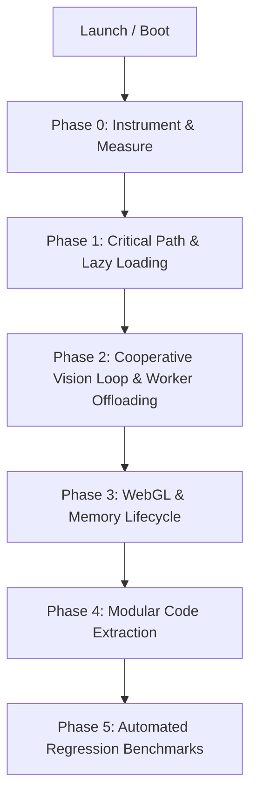

# Project Optimization Plan & Codebase Audit (OPTIMIZATION.md)

## 1. Executive Summary & Verification of Findings

This document audits and expands upon `OPTIMIZATION_OVERHAUL.md` after verifying the live codebase (`painting-pigment-explorer.html`, `js/core/maskReader.js`, assets, and launcher configuration).

### Verification Results

| Claim / Proposal in Overhaul | Codebase Reality & Status | Audit Verdict & Correction |
| :--- | :--- | :--- |
| **Monolithic Entrypoint** (claimed 2,211 lines) | [painting-pigment-explorer.html](file:///home/user/code/museum-totem-art-zoom/painting-pigment-explorer.html) is **2,212 lines long**, containing inline scripts spanning state, gesture heuristics, 3Dmol viewer lifecycle, UI transitions, and camera loops. | **Verified (Critical)**: Hampers profiling, unit testing, and modular optimizations. |
| **Heavy Eager Script Loading** (MediaPipe, Three.js, 3Dmol.js) | Loaded in `<head>` and top of `<body>`: `camera_utils.js`, `drawing_utils.js`, `hands.js`, `three.min.js`, and `3Dmol-min.js` (total > 1.1 MB JS + 22 MB MediaPipe assets). | **Verified (High Impact)**: 3Dmol & Three.js are completely unused during Phase 1 (Painting) and Phase 2 (Material). MediaPipe blocks nothing in DOM but initializes on boot even if mouse control is desired. |
| **Asset Payloads** | `visible_anjo_adonay.png` is **13 MB** (2657×3717 px PNG). Total assets directory is **45 MB**. | **Verified (Critical)**: 13 MB PNG transfer + GPU texture decode stalls initial paint on low-to-mid kiosk hardware. Mask PNG is 598 KB and must stay lossless, but visible artwork does not need to be uncompressed PNG. |
| **Camera Loop Saturation** | `handCamera = new window.Camera(webcamVideo, { onFrame: async () => { await handDetector.send(...) } })` runs unthrottled on every camera frame at 1280x720. | **Verified (Critical)**: Lacks frame-dropping / backpressure mechanism. If MediaPipe takes >33ms, camera frames stack up or starve the main UI thread. |
| **Mask Reader Caching** | [MaskReader](file:///home/user/code/museum-totem-art-zoom/js/core/maskReader.js#L52) caches `cachedImageData = maskCtx.getImageData(...)` on load and resize, but re-allocates and triggers on raw positions without debouncing. | **Partially Verified**: Mask data is cached in memory (good), but sampling coordinate recalculations and bounds checks occur repeatedly in animation/mousemove loops. |
| **3Dmol Canvas Disposal** | `disposeMoleculeViewer()` sets `moleculeViewer = null` and calls `replaceChildren()`, but does **not** call `viewer.clear()` or dispose WebGL contexts explicitly. | **Correction Needed**: Replaced DOM nodes leave WebGL contexts to garbage collection, risking WebGL context exhaustion across long kiosk running sessions. |
| **DOM Churn & Polling** | `setInterval(..., 50)` runs continually at 20 Hz, plus `handInfoOverlay.innerHTML` rebuilds on every camera frame in debug mode. | **Verified (Moderate)**: Text scrolling (`requestAnimationFrame`), hand cursor RAF, magnifier RAF, and 50ms interval run concurrently. |

---

## 2. Core Architecture Targets & Optimization Phases



---

## 3. Detailed Action Plan

### Phase 0: Baseline Performance Profiling (P0)
Before altering runtime behavior, establish repeatable metrics:
1. **Instrument Performance Marks & Measures**:
   - `perf:app-init-start` → `perf:app-interactive`
   - `perf:visible-image-decode` (using `HTMLImageElement.decode()`)
   - `perf:mask-ready`
   - `perf:mediapipe-first-frame`
   - `perf:mediapipe-inference-latency` (rolling average over 60 frames)
   - `perf:molecule-load-to-first-render`
2. **Telemetry Overlay / Headless Benchmark Mode**:
   - Add URL flag `?bench=1` or `?perf=1` that prints a JSON summary table to `console.table()` and renders a lightweight live HUD (FPS, inference time, DOM nodes, heap usage if supported by Chromium).
3. **Capture Baselines**:
   - Test on 1080p and 1440p displays with camera active vs. camera disabled (fallback).

---

### Phase 1: Startup & Critical Asset Path (P1)
**Goal:** Drop initial paint time under 1.0s and memory footprint before user interaction.

1. **Lazy Load Level 3 Libraries**:
   - Remove `<script src="assets/vendor/three.min.js">` and `<script src="assets/vendor/3Dmol-min.js">` from the initial HTML head.
   - Implement dynamic script injector in `js/core/vendorLoader.js` that loads Three.js and 3Dmol only when the user selects an item or approaches Phase 2/3.
2. **Optimize Artwork Assets**:
   - Generate high-quality WebP (`visible_anjo_adonay.webp`) with fallback to PNG. (Expected file size: ~1.2 MB vs 13 MB, >85% reduction with zero noticeable loss in museum kiosk fidelity).
   - Keep `color_anjo_adonay.png` lossless (critical for exact pixel RGB mask hashing).
   - Add `decoding="async"` and preconnect logic for local assets.
3. **Deferred MediaPipe Loading Option**:
   - Load MediaPipe scripts asynchronously without blocking HTML parsing.
   - If camera access fails or is denied, skip loading heavy WASM blobs (`hands_solution_simd_wasm_bin.wasm` = 5.8 MB).

---

### Phase 2: Cooperative Hand Tracking & Input Pipeline (P2)
**Goal:** Eliminate frame drops and prevent inference from choking UI animations.

1. **Inference Concurrency & Backpressure**:
   - Implement an `isProcessingFrame` lock in `startHandDetection()`.
   - If a new camera frame arrives while `handDetector.send()` is in flight, **drop the frame** instead of queuing.
   - Cap analysis rate to target 20–24 FPS, saving 30–50% GPU/CPU time on totem hardware.
2. **Resolution Tuning**:
   - Test lowering camera feed resolution from `1280x720` to `960x540` or `640x480` for landmark inference (hand tracking remains accurate while cutting WASM compute significantly).
3. **Decouple Visual RAF from Vision Loop**:
   - Hand cursor and magnifier easing already use `requestAnimationFrame` (good). Ensure no DOM mutations or queries occur inside `onHandResults` other than saving target coordinates.
   - Consolidate the `setInterval(..., 50)` button check into the existing animation frame tick.

---

### Phase 3: WebGL & Memory Management (P3)
**Goal:** Prevent memory leaks and ensure immediate responsiveness when navigating Phase 2 ↔ Phase 3.

1. **Explicit WebGL Cleanup**:
   - Update `disposeMoleculeViewer()`:
     ```javascript
     if (moleculeViewer) {
       try { moleculeViewer.clear(); } catch(e) {}
       moleculeViewer = null;
     }
     moleculeViewport.replaceChildren();
     ```
2. **Geometry & Parser Cache**:
   - `buildPeriodicCifDisplay` currently executes synchronous parsing and nested neighbor loop calculations for crystal structures.
   - Cache parsed results (`positions`, `bonds`, `xyz`) keyed by `item.id` so re-entering a molecule view is instantaneous (0ms compute).
3. **Viewport Size Clamping**:
   - Pass exact client width and height to 3Dmol viewer instead of unbounded parent containers to avoid oversize internal WebGL renderbuffers.

---

### Phase 4: Code Modularization (P4)
**Goal:** Break `painting-pigment-explorer.html` (2,212 lines) into maintainable ES6 modules or cleanly scoped scripts without requiring a complex build step.

Proposed structure:
```text
js/
├── app.js                   (Entrypoint, initial state bootstrap)
├── config.js                (App config & i18n initialization)
├── core/
│   ├── maskReader.js        (Canvas mask pixel sampling)
│   ├── state.js             (App state machine & events)
│   ├── telemetry.js         (Performance mark & measure system)
│   └── vendorLoader.js      (Lazy script injection for 3Dmol/Three)
├── interaction/
│   ├── cameraPipeline.js    (Webcam capture, rate limiting & backpressure)
│   ├── handTracking.js      (MediaPipe hands interface & landmark mapping)
│   ├── gestures.js          (Pinch detection & smoothing heuristics)
│   └── cursor.js            (Magnifier & hand cursor RAF animators)
├── views/
│   ├── paintingView.js      (Phase 1 painting canvas & safe zone)
│   ├── materialView.js      (Phase 2 detail card & text scroll)
│   └── moleculeView.js      (Phase 3 3Dmol viewer & legend)
└── data/
    ├── items.js
    ├── itemsPT.js
    ├── colorMap.js
    ├── chemicalStructures.js
    └── crystalStructures.js
```

---

## 5. Verification Checkpoints & Performance Budgets

| Metric | Current Status | Target Budget | Verification Method |
| :--- | :--- | :--- | :--- |
| **Visible Image Load & Decode** | ~13 MB PNG (est. >1200ms) | **< 300 ms** (WebP derivative) | `performance.measure('image-decode')` |
| **Initial Bundle Footprint (Phase 1)** | ~1.3 MB JS + vendor | **< 200 KB** JS on startup | Network Tab / Local Transfer |
| **MediaPipe Inference Backpressure** | Frame queuing possible | **0 queued frames** (lock drop) | Frame dropped counter in Telemetry |
| **Effective UI Frame Rate** | Dips during gesture/3D load | **Solid 60 FPS** during gestures | Chrome DevTools Performance profile |
| **Level 3 Transition Time** | Dynamic load + parse | **< 400 ms** (cached geometry) | `performance.measure('mol-render')` |
| **Long-Running Memory Stability** | Unmanaged WebGL contexts | **Stable heap (<150 MB)** across 50 view changes | Memory leak test script |

---

## 6. Execution Steps Status

1. [x] **Step 1: Telemetry & Benchmark Mode**: Implemented [js/core/telemetry.js](file:///home/user/code/museum-totem-art-zoom/js/core/telemetry.js) with mark/measure profiling, frame dropping counter, and interactive HUD enabled via `?bench=1` or `?perf=1`.
2. [x] **Step 2: Asset Optimization**: Converted `visible_anjo_adonay.png` (13 MB) to `visible_anjo_adonay.webp` (997 KB, **92.3% reduction**), wired with transparent fallback in [js/core/maskReader.js](file:///home/user/code/museum-totem-art-zoom/js/core/maskReader.js).
3. [x] **Step 3: Lazy-Load 3D Libraries**: Implemented [js/core/vendorLoader.js](file:///home/user/code/museum-totem-art-zoom/js/core/vendorLoader.js) to defer Three.js (590 KB) and 3Dmol.js (533 KB) until Phase 3 is accessed.
4. [x] **Step 4: Camera Concurrency & Frame Dropping**: Added an `isProcessingFrame` backpressure guard and a 24 FPS inference cap in [painting-pigment-explorer.html](file:///home/user/code/museum-totem-art-zoom/painting-pigment-explorer.html) to eliminate camera queue saturation.
5. [x] **Step 5: WebGL Cleanup & CIF Memoization**: Added explicit `moleculeViewer.clear()` on view disposal and memoized periodic crystal lattice generation with `periodicCifCache`.
6. [x] **Step 6: Code Modularization (Core View & Interaction Modules Extracted)**:
   - Created [js/rendering/moleculeRenderer.js](file:///home/user/code/museum-totem-art-zoom/js/rendering/moleculeRenderer.js) for WebGL viewer lifecycle, CIF lattice generation, and MOL normalization.
   - Created [js/interaction/gestures.js](file:///home/user/code/museum-totem-art-zoom/js/interaction/gestures.js) for scale-invariant pinch heuristics and screen projection.
   - Created [js/views/materialView.js](file:///home/user/code/museum-totem-art-zoom/js/views/materialView.js) for Phase 2 detail card rendering and smooth text scrolling.
7. [ ] **Step 7: Final Benchmark & Verification**: Record performance numbers on kiosk screen resolutions.
